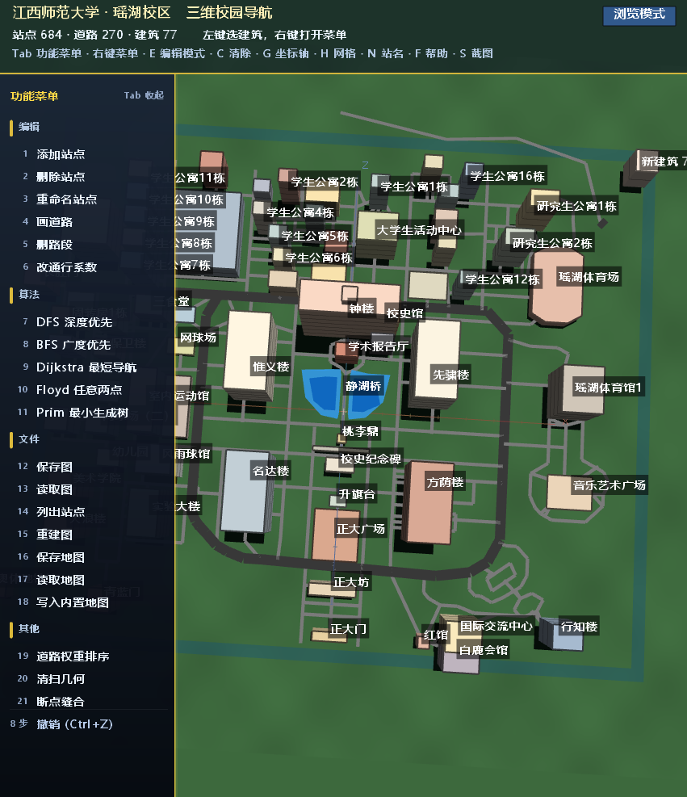
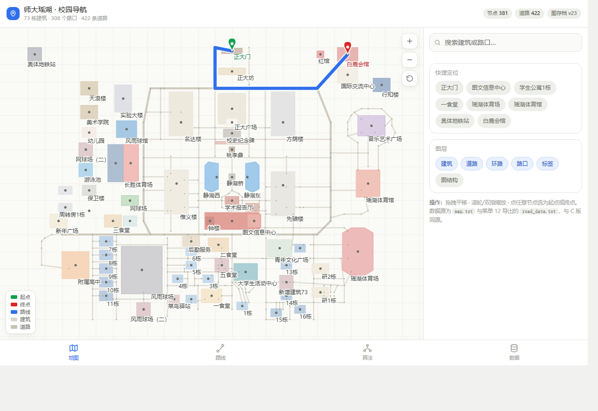
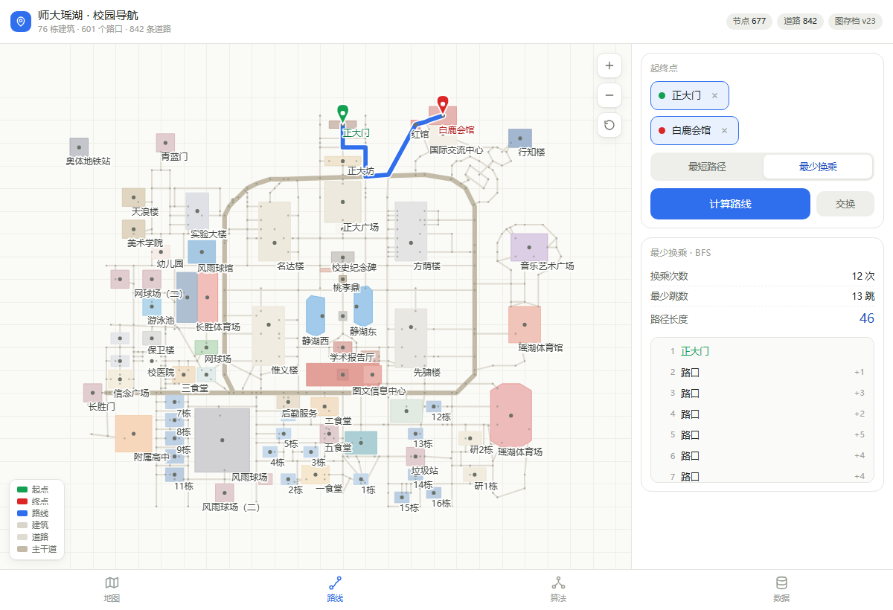
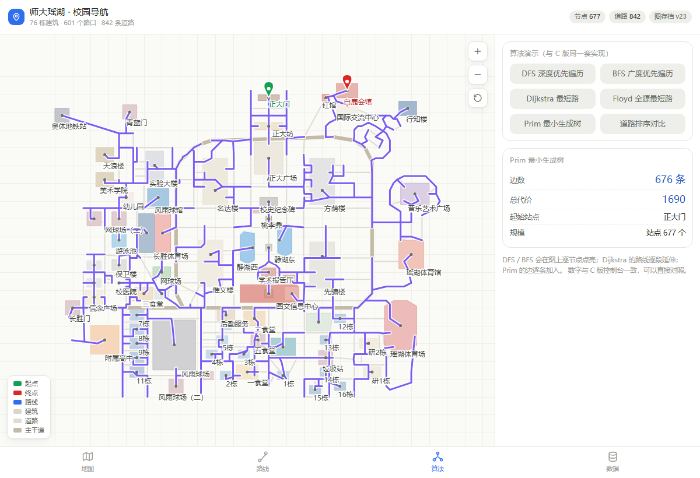

# 师大瑶湖 · 校园导航

基于 **C + OpenGL (freeglut)** 的三维校园导航程序，配套一份同源网页版。
覆盖校园 **76 栋建筑、677 个节点（76 个地点 + 601 个路网节点）、842 条道路**，
支持最短路径、最少换乘、最小生成树与图遍历演示。

**桌面版（C + OpenGL，真实运行截图）**



<sub>桌面版截图取自 2026-10-25 构建（与仓库内 campus.exe 同版本）；此后地图数据有小幅更新。</sub>

**网页版（与桌面版同一套数据）**





---

## 功能

**地图浏览与编辑**（侧边栏菜单 1–6、14–18、20–21）

| 菜单 | 功能 |
| --- | --- |
| 1–3 | 添加站点 / 删除站点 / 重命名站点 |
| 4–6 | 画道路 / 删路段 / **改通行系数**（加权路网） |
| 14 / 15 | 列出全部站点 / 重建图 |
| 16–18 | 保存地图 / 读取地图 / 写入内置地图 |
| 20 / 21 | 清扫几何 / **断点缝合**（清理退化几何、把断开的边重新接上） |

三维视图支持鼠标旋转 / 缩放 / 平移；建筑按真实轮廓多边形绘制，道路按等级分色；
右键还有「新建建筑 / 删除建筑 / 重命名建筑 / 添加道路 / 删除道路」的快捷菜单。

**图算法**（菜单 7–11、19）

| 菜单 | 算法 | 说明 |
| --- | --- | --- |
| 9 | **Dijkstra** | 最短路径，按步行距离计算，起终点任意选择，路径高亮 |
| 8 | **BFS** | 最少换乘：按**跳数**求换乘最少的路线 |
| 10 | **Floyd** | 任意两点最短路：一次算出全源距离表 + 前驱表 |
| 11 | **Prim** | 最小生成树：连通全校路网的最小代价方案 |
| 7 | **DFS** | 深度优先遍历，逐步高亮访问顺序 |
| 19 | **快速排序** | 按权重排序道路边并输出路网报告（手写快排） |

算法结果会在三维视图里逐步高亮，数据面板实时显示节点数、边数、选中建筑信息与算法耗时。

## 两种版本

- **桌面版**：`main.c` 单文件，C + freeglut/OpenGL，Windows 下运行
- **网页版**：`web/index.html`，浏览器直接打开即可，无需安装（数据在 `web/campus_data.js`）

## 运行

**直接跑（免编译）**

```
campus.exe          需要同目录下的 libfreeglut.dll
```

> `campus.exe` 构建于 **2026-10-25**。此后 `main.c` 的改动**只有注释**——
> 去掉注释与空白后，与构建时的源码逐字符一致（238,686 字符），
> 所以这个 exe 的功能与当前源码相同，可以直接运行。

**自己编译（MinGW-w64 示例）**

```bash
gcc main.c -o campus.exe -O2 -mwindows \
    -lfreeglut -lopengl32 -lglu32 -lwinmm
```

> 需要 freeglut 开发包（头文件 + `libfreeglut.a`）。用 MSVC 时同样需要 freeglut 的 lib，
> 并在项目属性里链接 `opengl32.lib glu32.lib winmm.lib`。

## 数据文件

| 文件 | 内容 |
| --- | --- |
| `map.txt` | `VERSION 1` / `BUILDINGS 76`，每行一栋建筑：名称、坐标、高度、RGB、顶点数与多边形顶点 |
| `road_data.txt` | `VERSION 23` / 节点数 677（76 个地点 + 601 个路网节点）、842 条边；先列节点（id、名称、坐标），再列边与权重 |
| `map_bak1.txt` / `map_bak2.txt` | **运行时自动生成**的滚动备份：每次「16.保存地图」会把 map.txt → bak1 → bak2 依次后移；map.txt 缺失或损坏时程序自动回退加载。仓库不收录（见 `.gitignore`） |
| `osm_export/` | 原始测绘数据与比对报告（见下方署名） |

## 数据采集脚本

`get_buildings.py` 用高德 Web 服务 API 批量取建筑经纬度，再换算成 3D 场景坐标。
**Key 不写在代码里**，从环境变量读取：

```bash
# PowerShell
$env:AMAP_KEY="你的Key"; python get_buildings.py

# cmd
set AMAP_KEY=你的Key && python get_buildings.py

# bash
AMAP_KEY=你的Key python get_buildings.py
```

没设置会直接退出并提示。脚本依赖 `requests`（`pip install requests`）。

## 测绘数据来源（重要）

`osm_export/` 与地图文件中的建筑轮廓来自 **OpenStreetMap**，遵循
**Open Database License (ODbL) 1.0**：

- 必须署名：**© OpenStreetMap contributors**（https://www.openstreetmap.org/copyright）
- 若基于该数据发布衍生数据库，需以相同许可（ODbL）开放

取数时间 2026-09-25，方式为 Overpass API。详见 `osm_export/NOTICE.txt`。

> `osm_export/` 里的三份报告（对比 / 补全 / 定位）是**当时的数据处理记录**，
> 反映的是 73 栋建筑的中期状态；此后地图已补全到 76 栋，报告内容未再更新，仅作来源凭证保留。

> 换言之：**代码**你可以自行决定许可；但**地图数据**受 ODbL 约束，转载或再分发时要保留署名。

## 目录结构

```
main.c                桌面版全部源码（地图渲染 + 图算法 + 交互）
campus.exe            预编译可执行文件（Windows x64）
libfreeglut.dll       freeglut 运行库
map.txt               建筑数据
road_data.txt         路网数据（节点 + 边）
get_buildings.py      调高德 API 取建筑坐标、生成 map.txt 的脚本（Key 走环境变量）
web/                  网页版（index.html + campus_data.js + 界面截图）
osm_export/           OSM 原始数据、比对报告与许可说明
docs/screenshots/     README 用截图
```
